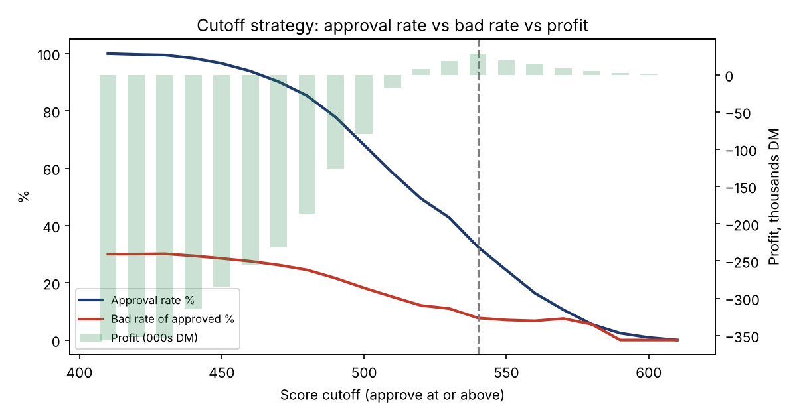

# Credit Risk Acquisitions: Application Scorecard and Adjudication Strategy


Which credit applications should a lender approve? This project builds an **application scorecard** on 1,000 real consumer credit applications, then turns it into an **adjudication strategy**: the score cutoff, its approval rate, bad rate and expected loss, a **business case**, and a **champion vs challenger** test against a rules-only policy. Results go into an **Excel workbook** and a **PowerPoint briefing** for management.

## Results

| | |
|---|---|
| Applications | 1,000 (30% bad outcomes) |
| Scorecard (WoE logistic regression), 5-fold cross-validated | **AUC 0.771, Gini 0.541, KS 0.429** |
| Gradient boosting challenger model | AUC 0.763, Gini 0.527 (scorecard kept: as good and explainable) |
| **Champion vs challenger at the same approval rate (~87%)** | bad rate **28.0% → 25.1%**, expected loss **367,530 → 349,123 DM** |
| Swap set | swap-ins go bad 33% of the time, swap-outs **62%**: the scorecard declines the right applicants |
| Profit-maximizing cutoff (LGD 45%, margin 4%) | cutoff 540: approve 32.5%, bad rate 7.7%, loss rate 3.6% |
| Business case sensitivity | with a 6–8% margin the best cutoff moves to 520–530 (approve 43–49%) |
| Score stability (PSI) | 0.018 (stable) |
| **Operations: three-band strategy** | auto-approve 540+ (32.5%, 7.7% bad), refer 520–539 to manual review (16.9%, 20.7% bad), auto-decline (50.6%, 47.4% bad) |
| Operational effectiveness | **83% auto-decisioned**; about 80 manual reviews a day (3.8 adjudicators at 10,000 applications/month); a wider 500–539 band would need 8.1 |
| **Marketing targeting** | 4 segments to target (e.g. used cars 13–24 months: 57% approval, 10% bad), 7 to avoid |



## What it does

1. **Data assets.** Loads the applications and documents every field in a data dictionary (`cra/data.py`).
2. **Characteristic analysis.** Weight of Evidence binning and Information Value for every characteristic. Strongest: checking account status (IV 0.66), credit history (0.29) and loan term (0.21).
3. **Scorecard.** Logistic regression on WoE features, scaled to points (600 = 50:1 odds, 20 points to double the odds). Every attribute's points are published, so each decision can be explained.
4. **Validation.** 5-fold cross-validation (each application is scored by a model that never saw it); AUC, Gini and KS; a gradient boosting challenger for comparison.
5. **Adjudication strategy.** For every cutoff: approval rate, bad rate, approved amount, **expected loss** (bads × amount × LGD), net revenue and profit.
6. **Business case.** The profit-maximizing cutoff, plus a sensitivity table across margins (4–8%) and loss-given-default (35–60%).
7. **Champion vs challenger.** A rules-only policy (knock-out rules) against the scorecard at the same approval rate, with **swap-set analysis**.
8. **Application outcomes by segment.** Approval and bad rates by purpose, age band, term and amount, computed with **SQL** (SQLite).
9. **Operations.** A three-band strategy (auto-approve / refer to manual review / auto-decline), the auto-decision rate, review queue per day and adjudicators needed, and refer-band options so Risk and Operations can agree the band.
10. **Marketing.** Profit per application by purpose and term, with a target / neutral / avoid recommendation for acquisition campaigns.
11. **Cloud-based analytics.** The scored applications are exported for **Google BigQuery**, and the strategy is reproduced with SQL in `sql/bigquery/` (see [the BigQuery guide](docs/BIGQUERY.md)). The SQL was checked against the Python results.
12. **Risk governance.** Protected attributes excluded, a population stability index (PSI) for monitoring, a fairness check by age band, and a [model card](docs/MODEL_CARD.md) with limitations.
13. **Reporting.** `output/credit_strategy.xlsx` (17 sheets, with a chart) and `output/credit_strategy_briefing.pptx` (8 slides).

## Run it

```bash
pip install -r requirements.txt
python -m cra          # writes the Excel workbook, PowerPoint, charts and summary into output/
pytest                 # 17 tests
```

On Windows Command Prompt the same commands work; open `output\credit_strategy.xlsx` in Excel.

## Honest limits

- 1,000 historical applications, amounts in Deutsche Mark: good for showing the method, too small and old for a real lender.
- Loss given default and margin are assumptions, so the cutoff should be set with Finance's real numbers (see the sensitivity table).
- Review time (20 minutes) and volume (10,000 applications a month) are assumptions for sizing the review queue.
- Age-band approval rates differ even though age is not an input; the model card flags this for compliance review.

## Tech

Python · pandas · NumPy · scikit-learn · SQL (SQLite, Google BigQuery) · Matplotlib · openpyxl (Excel) · python-pptx (PowerPoint) · pytest · GitHub Actions

Data: German Credit (Hofmann), UCI Machine Learning Repository, CC BY 4.0.
